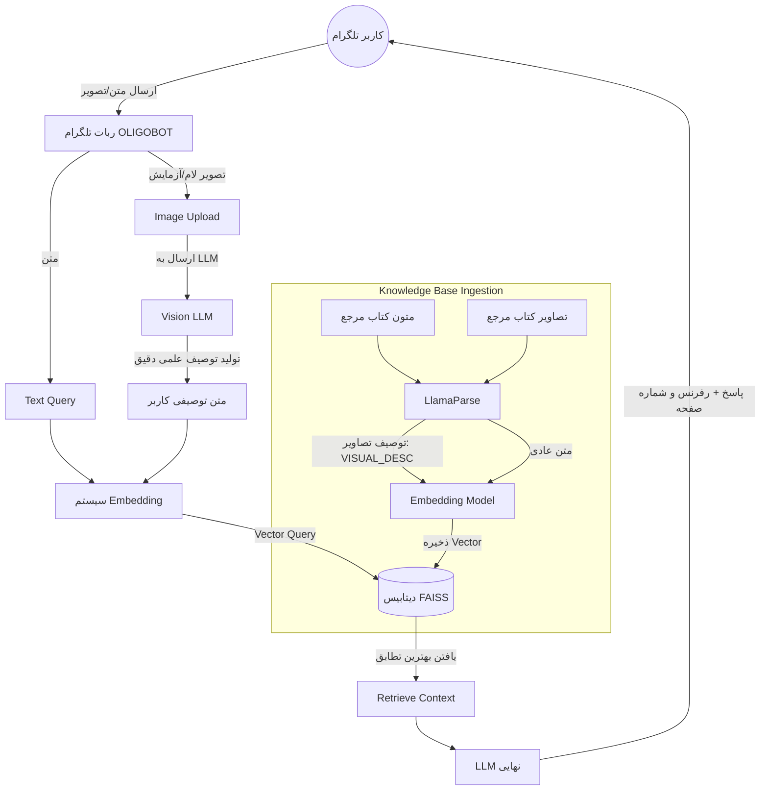

# 🗺️ نقشه معماری سیستم RAG و رفع خطای FAISS

با بررسی توضیحات دقیق شما و همچنین کدهای سیستم (مثل `faiss_ingest.py`، `async_rag_search.py` و `vision.py`)، کاملاً متوجه ساختار هوشمندانه شما شدم. شما در واقع از روش **Text-to-Text Image Retrieval** (توصیف تصویر به کمک LLM و مچ کردن آن با توصیف‌های استخراج شده توسط LlamaParse) استفاده می‌کنید. این روش بسیار خلاقانه است و دقت بالایی در درک "مفهوم پزشکی" تصویر دارد.

در این سند، ابتدا نقشه کلی سیستم شما را رسم کرده‌ام، سپس دلیل احتمالی کرش کردن FAISS را بررسی کرده و در نهایت پیشنهاداتی برای بهبود ارائه داده‌ام.

---

## 🏗️ نقشه کلی سیستم RAG فعلی (طبق معماری شما)

در این معماری، ما دو مسیر اصلی برای پردازش درخواست‌ها داریم: یکی برای متون و دیگری برای تصاویر.

---

## 🚨 تحلیل مشکل ناهماهنگی FAISS و Embedding

شما اشاره کردید که *"هنگام اجرای ربات اصلا نمیتونه کتابخونه های faiss رو بخونه"*. با بررسی سورس کدها، این مشکل ناشی از **ناهماهنگی در کلاس‌های امبدینگ و نحوه Serialize شدن FAISS** است. دلایل اصلی به شرح زیر هستند:

1. **کلاس‌های سفارشی (Custom Classes) در پیکِل (Pickle):**
   در فایل `faiss_ingest.py`، شما از یک کلاس دست‌ساز به نام `GoogleGenerativeAIEmbeddings` استفاده کرده‌اید. وقتی FAISS دیتابیس را ذخیره می‌کند، فایل `index.pkl` در برخی مواقع وابستگی‌هایی به ماژول‌های زمان ذخیره‌سازی پیدا می‌کند. هنگام فراخوانی در `async_rag_search.py` این کلاس‌ها ممکن است یافت نشوند و خطای Deserialization بدهند.
2. **سیستم Auto-Correct ابعاد (Dimension Mismatch):**
   در فایل `async_rag_search.py` (خطوط 220 تا 248) یک سیستم تصحیح خودکار قرار دارد. اگر هنگام لود کردن FAISS، اتصال به API گوگل برقرار نشود یا سایز وکتورها حتی یک واحد اختلاف داشته باشند، سیستم سعی می‌کند به مدل‌های Local مثل `sentence-transformers` سوئیچ کند و چون این کتابخانه‌ها در محیط فعلی به درستی در دسترس نیستند (یا کانفیگ نشدند)، کل سیستم FAISS کرش می‌کند و ربات نمی‌تواند آن را بخواند.
3. **عدم تطابق پچ Pydantic v2:**
   پچی که برای سازگاری Pydantic در `faiss_ingest.py` (خط 21) گذاشته‌اید، در فایل اجرایی ربات (`async_rag_search.py`) وجود ندارد، که باعث خطای لود کردن داکیومنت‌های Langchain می‌شود.

---

## 💡 پیشنهادات برای بهبود سیستم تصویر (Vision RAG)

روش فعلی شما (توصیف LLM -> تبدیل به وکتور -> جستجو در FAISS) بسیار عالی است زیرا LLM مفهوم پاتولوژی (مثل "تعداد زیادی بلاست رده میلوئیدی") را درک می‌کند. اما نقطه ضعف این است که اگر LLM در توصیف عکس کاربر دچار اشتباه شود (Hallucination)، سیستم RAG به طور کلی مسیر اشتباهی را برای جستجو در پیش می‌گیرد.

**پیشنهاد طلایی: سیستم هیبریدی (توصیف معنایی + بینایی ماشین)**
در حال حاضر یک فایل به نام `vision.py` در سیستم شما وجود دارد که از مدل `clip-ViT-B-32` استفاده می‌کند. پیشنهاد من ترکیب این دو سیستم است:

1. **لایه اول (تشخیص بصری خام - CLIP):** ابتدا عکس کاربر توسط سیستم CLIP با عکس‌های موجود در اطلس (در ChromaDB یا پنل RAG اختصاصی شما) مقایسه شود تا 5 عکس مشابه از نظر بافت و شکل پیدا شود.
2. **لایه دوم (درک معنایی - LLM):** همزمان LLM عکس کاربر را توصیف کند و متن توصیف‌شده را در دیتابیس FAISS (که حاوی متون کتب رفرنس است) جستجو کند.
3. **تصمیم‌گیری نهایی:** LLM خروجی هر دو جستجو را دریافت کند. یعنی هم نتایج بصری مشابه و هم متون رفرنس مشابه. در این حالت امکان تشخیص اشتباه تقریباً به صفر می‌رسد.

---

> [!IMPORTANT]  
> **سوالات باز برای همفکری (لطفاً پاسخ دهید تا اجرای کد را شروع کنم):**

1. **نوع خطای FAISS:** آیا در محیط اجرای ربات ارور خاصی مثل `ModuleNotFoundError`، یا ارور `Dimension Mismatch` یا ارور مربوط به `Pickle` در کنسول می‌گیرید؟
2. **پچ Pydantic:** آیا موافق هستید پچ مربوط به نسخه Langchain را به `async_rag_search.py` منتقل کنم و سیستم Auto-Correct ابعاد را بهینه کنم تا جلوی کرش کردن FAISS را بگیرم؟
3. **روش ترکیبی RAG تصاویر:** آیا مایلید استراتژی ترکیب مدل CLIP (مقایسه مستقیم عکس با عکس) و مدل LLM (توصیف عکس) را در معماری جدید پیاده‌سازی کنیم؟ یا ترجیح می‌دهید فعلاً فقط باگ خواندن FAISS را برای همین سیستم فعلی برطرف کنیم؟
4. **پنل اختصاصی:** فرمودید پنل اختصاصی RAG ساختید. آیا این پنل خروجی `.faiss` و `.pkl` به شما می‌دهد که در پوشه `brain_index` قرار می‌دهید؟
