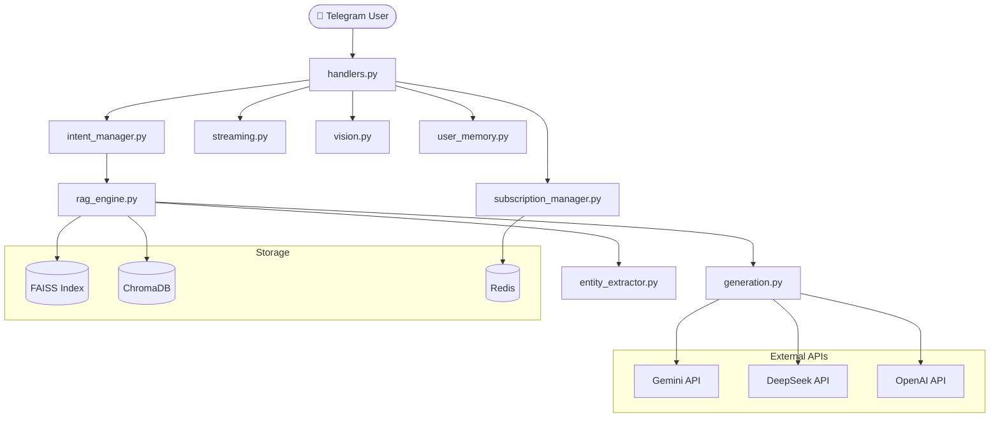

# 🤖 OLIGOBOT — Medical RAG Telegram Bot

[](https://www.python.org/)
[](LICENSE)
[](Dockerfile)
[](https://core.telegram.org/bots)

> **A production-ready medical knowledge assistant powered by Retrieval-Augmented Generation (RAG), multi-LLM orchestration, and Telegram integration — specialized in clinical laboratory sciences.**

---

## ✨ Key Features

| Category | Features |
|----------|----------|
| 🧠 **Multi-LLM** | Gemini · DeepSeek · OpenAI — automatic failover & key rotation |
| 🔍 **Hybrid Search** | FAISS vector search + ChromaDB + BM25 keyword retrieval |
| 🏥 **Medical Domains** | Hematology · Pathology · Cytopathology · Urinalysis · Parasitology |
| 🔬 **Vision AI** | Microscope slide analysis with cell counting & morphology detection |
| ⚡ **Streaming** | Real-time token-by-token response delivery |
| 💾 **User Memory** | Persistent conversation context & topic tracking per user |
| 🎫 **Subscriptions** | Tiered quotas — Free / Basic / Pro / Enterprise |
| 📊 **Admin Panel** | FastAPI dashboard for monitoring & user management |
| 🛡️ **Security** | Input validation · prompt injection protection · API key encryption |
| 📖 **Citations** | Auto-referenced answers with source book, page & section |

---

## 🏗️ Architecture



---

## 🚀 Quick Start

### Prerequisites

- Python 3.11+
- Redis server *(optional, for caching)*
- At least one AI provider API key (Gemini recommended for free tier)

### Local Setup

```bash
# 1. Clone the repository
git clone https://github.com/mrramzy/oligobot-.git
cd oligobot

# 2. Create virtual environment
python -m venv venv
# Windows:
venv\Scripts\activate
# Linux/Mac:
source venv/bin/activate

# 3. Install dependencies
pip install -r requirements.txt

# 4. Configure environment
cp .env.example .env
# Edit .env with your API keys (see Environment Variables)

# 5. Run the bot
python app.py
```

### 🐳 Docker

```bash
# 1. Configure
cp .env.example .env
# Edit .env with your API keys

# 2. Build and start
docker compose up -d

# 3. View logs
docker compose logs -f bot

# 4. Stop
docker compose down
```

The Docker setup includes:
- **bot** — OLIGOBOT application (Python 3.11-slim, non-root user)
- **redis** — Redis 7 Alpine for caching

---

## ⚙️ Environment Variables

| Variable | Required | Default | Description |
|----------|:--------:|---------|-------------|
| `TELEGRAM_TOKEN` | ✅ | — | Bot token from [@BotFather](https://t.me/BotFather) |
| `ADMIN_ID` | ✅ | — | Your Telegram user ID for admin access |
| `ADMIN_SECRET` | ❌ | `change-me-in-production` | Admin dashboard secret key |
| **AI Providers** *(at least one required)* |
| `GOOGLE_API_KEY` | ⚡ | — | Google Gemini API key (comma-separated for rotation) |
| `OPENAI_API_KEY` | ⚡ | — | OpenAI API key |
| `DEEPSEEK_API_KEY` | ⚡ | — | DeepSeek API key |
| **ArvanCloud** |
| `ARVAN_API_KEY` | ❌ | — | ArvanCloud API key (for embeddings) |
| `ARVAN_EMBEDDING_BASE_URL` | ❌ | `https://ai-saas.arvancloud.ir/ai/v1` | ArvanCloud endpoint |
| `ARVAN_EMBEDDING_MODEL` | ❌ | `bge-m3` | Embedding model name |
| **Redis** |
| `REDIS_HOST` | ❌ | `localhost` | Redis server host |
| `REDIS_PORT` | ❌ | `6379` | Redis server port |
| **Routing** |
| `LLM_PROFILE` | ❌ | `1` | 1 = Gemini Free · 2 = ArvanCloud · 3 = Gemma-4-31B |
| `EMBEDDING_PROVIDER` | ❌ | `arvan` | `arvan` / `gemini` / `openai` / `local` |

---

## 📁 Project Structure

```
oligobot/
├── app.py                      # Main entry point & Telegram bot
├── config.py                   # Configuration & environment loading
├── requirements.txt            # Python dependencies
├── Dockerfile                  # Multi-stage container image
├── docker-compose.yml          # Docker Compose setup
├── .env.example                # Environment variable template
│
├── rag_engine.py               # RAG orchestrator
├── async_rag_search.py         # Async vector search (FAISS + ChromaDB)
├── embeddings.py               # Multi-provider embedding manager
├── generation.py               # LLM response generation
├── streaming.py                # Real-time streaming support
├── vision.py                   # Medical image analysis
│
├── handlers.py                 # Telegram message handlers
├── ui_handlers.py              # Inline keyboard UI handlers
├── conversation_manager.py     # Chat history management
├── user_manager.py             # User CRUD operations
├── user_memory.py              # Persistent user memory & topics
│
├── intent_manager.py           # Intent detection & classification
├── query_refinement.py         # Query rewriting for better retrieval
├── keyword_extractor.py        # Medical keyword extraction
├── entity_extractor.py         # Medical entity recognition
├── citation_manager.py         # Source citation & referencing
├── prompt_builder.py           # Prompt template construction
│
├── subscription_manager.py     # Subscription tiers & quotas
├── key_manager.py              # API key rotation & management
├── retry_utils.py              # Centralized retry/backoff logic
├── exceptions.py               # Custom exception hierarchy
├── input_validator.py          # Input sanitization & validation
├── logging_config.py           # Structured JSON logging
│
├── admin_api.py                # FastAPI admin dashboard API
├── admin_dashboard.html        # Admin dashboard frontend
│
├── PSL/                        # Prompt Service Layer (system prompts)
│   ├── system_core.md
│   ├── hematology.md
│   ├── pathology.md
│   ├── cytopathology.md
│   ├── urinalysis.md
│   └── parasitology.md
│
├── clinical_rag/               # Clinical RAG data pipeline
│   ├── faiss_ingest.py         # FAISS index builder
│   ├── merger_of_indexes.py    # Index merger utility
│   └── retrieve.py             # Retrieval functions
│
└── tests/                      # Test suite
    ├── conftest.py
    └── ...
```

---

## 🧪 Testing

```bash
# Run all tests
pytest tests/ -v

# Run with coverage report
pytest tests/ --cov=. --cov-report=html

# Run specific test
pytest tests/test_exceptions.py -v
```

---

## 🤝 Contributing

Contributions are welcome! Areas where help is needed:

1. 📈 Expand test coverage (target: 80%)
2. 🏷️ Add type hints to async functions
3. ⚠️ Improve error handling in hot paths
4. 📚 Expand medical knowledge base
5. 🌍 Internationalization (i18n) support

---

## ⚠️ Medical Disclaimer

> [!WARNING]
> **OLIGOBOT is an academic and experimental research prototype** intended solely for educational, informational, and research purposes in clinical laboratory sciences.
>
> - **Not a Medical Device:** This system is NOT certified as a medical diagnostic device by any regulatory authority (e.g., FDA, CE, or health ministries) and is NOT intended for primary clinical diagnosis, treatment decisions, or direct patient care.
> - **No Doctor-Patient Relationship:** Information generated by this system does not constitute formal medical advice and cannot substitute for professional clinical judgment, expert consultation, or certified laboratory protocols.
> - **Professional Supervision Required:** All outputs, laboratory test interpretations, and microscopic morphology assessments must be independently reviewed and verified by certified clinical pathologists, medical laboratory scientists, or qualified healthcare professionals.
> - **Limitation of Liability:** The authors, developers, and maintainers assume no liability for any errors, omissions, clinical decisions, or damages resulting from the use or misuse of this software.

---

## 📄 License

This project is licensed under the MIT License — see the [LICENSE](LICENSE) file for details.

---

<p align="center">
  <b>OLIGOBOT</b> · Medical RAG Engine · Built with heart for clinical laboratory professionals and Medical Experts
</p>
<p align="center">
  <b>Hooman Ramezany</b> 
</p>
